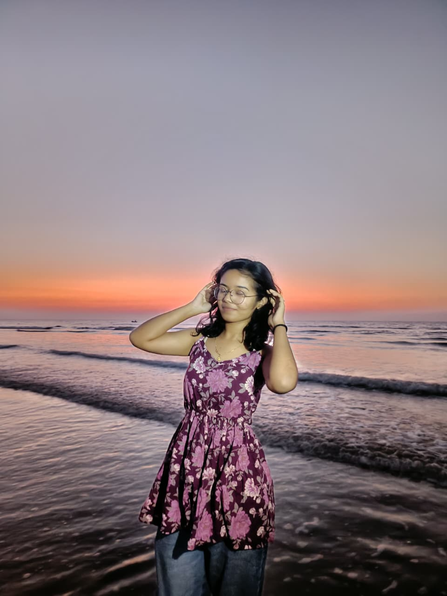

# ✨ Aditi Patil — Personal Portfolio

<p align="center">
  
</p>

<p align="center">
  <strong>B.Tech in Data Science | Aspiring Software Engineer | GATE 2028 Aspirant</strong><br>
  <em>"Learn . Build . Innovate"</em>
</p>

<p align="center">
  <a href="https://github.com/aditi22builds"></a>
  <a href="https://www.linkedin.com/in/aditi-patil-888560414/"></a>
  <a href="mailto:aditiii.work@gmail.com"></a>
</p>

---

## 🌟 Overview

Welcome to the repository of **Aditi Patil's interactive 3D developer portfolio**. This portfolio is built to reflect modern web standards, featuring interactive 3D physics, smooth inertial scrolling, fluid GSAP scroll interactions, glassmorphism aesthetics, and full responsive design.

---

## 🚀 Key Features

- **🎮 Interactive 3D Physics Lanyard Card**:
  - Realistic physics-based ID card and lanyard powered by **Three.js**, **@react-three/fiber**, and **@react-three/rapier**.
  - Users can click and drag the lanyard card in real-time with responsive physics simulations.
  - Dynamically disabled on mobile viewports for smooth performance and optimal touch experience.

- **🌊 Smooth Inertial Scrolling**:
  - Integrated with **Lenis** to provide silky-smooth, momentum-based scrolling across all sections.

- **🎨 GSAP & ScrollTrigger Animations**:
  - Staggered entrances for headers, skill categories, and project cards.
  - Interactive magnetic effects on buttons and social icons.

- **🌓 Dynamic Dark / Light Mode**:
  - Persistent theme switching with custom CSS variable palettes and smooth color transitions.

- **🧭 Floating Glassmorphism Pill Navigation**:
  - Sticky glass navigation bar with active section tracking via Intersection Observer and one-click quick jump.

- **🤝 Credits & Collaboration Modal**:
  - Integrated credits modal acknowledging development collaboration with **Suraj Sawant**, featuring direct portfolio and social links.

- **📱 Fully Responsive Design**:
  - Thoughtfully designed typography, spacing, and animations tailored for desktops, tablets, and smartphones.

---

## 🛠️ Tech Stack

### **Frontend & Framework**
- **React 19** — Component-driven architecture
- **Vite** — Next-generation frontend build tooling & ultra-fast HMR

### **3D Graphics & Physics**
- **Three.js** — WebGL rendering engine
- **@react-three/fiber** — React renderer for Three.js
- **@react-three/drei** — Useful helpers for Three.js
- **@react-three/rapier** — High-performance 3D physics engine via WebAssembly
- **meshline** — Smooth 3D lanyard ribbon geometry

### **Animations & Interactivity**
- **GSAP (GreenSock)** & **ScrollTrigger** — Complex timelines & scroll-driven motion
- **Lenis** — Modern smooth scrolling library

### **Styling & Quality**
- **Modern CSS3** — Glassmorphism, CSS custom properties, responsive media queries
- **Oxlint** — High-performance JavaScript/React linter

---

## 📁 Project Structure

```text
Adti/
├── public/                 # Static public assets
├── src/
│   ├── assets/             # Images, avatars, and SVG graphics
│   ├── components/
│   │   ├── About/          # About section component & styles
│   │   ├── Contact/        # Contact section with magnetic email & socials
│   │   ├── Credits/        # Collaboration modal & credits trigger
│   │   ├── Cursor/         # Custom trailing magnetic cursor
│   │   ├── Footer/         # Footer with quick links & branding
│   │   ├── Hero/           # Hero section with 3D Lanyard integration
│   │   ├── Lanyard/        # 3D canvas, physics rope, & card GLB/SVG model
│   │   ├── Loader/         # Initial cinematic preloader screen
│   │   ├── Magnetic/       # Magnetic physics wrapper for buttons
│   │   ├── Navbar/         # Header navigation
│   │   ├── ParallaxBackground/ # Animated ambient light orbs
│   │   ├── PillNav/        # Floating pill navbar with theme toggle
│   │   ├── Projects/       # Showcase cards for projects
│   │   └── Skills/         # Categorized skills & learning tags
│   ├── App.css             # Main layout & theme definitions
│   ├── App.jsx             # Main application orchestrator
│   ├── index.css           # Global typography & reset rules
│   └── main.jsx            # React root entry point
├── index.html              # HTML shell & metadata
├── package.json            # Project dependencies & scripts
└── vite.config.js          # Vite build configuration
```

---

## ⚡ Getting Started

### Prerequisites

Ensure you have [Node.js](https://nodejs.org/) installed on your machine (v18+ recommended).

### 1. Clone the repository
```bash
git clone https://github.com/aditi22builds/My-Portfolio.git
cd My-Portfolio
```

### 2. Install dependencies
```bash
npm install
```

### 3. Start development server
```bash
npm run dev
```
Open [http://localhost:5173](http://localhost:5173) in your browser to view the application.

### 4. Build for production
```bash
npm run build
```

### 5. Preview production build
```bash
npm run preview
```

---

## 📬 Contact & Connect

- **Author**: Aditi Patil
- **GitHub**: [@aditi22builds](https://github.com/aditi22builds)
- **LinkedIn**: [Aditi Patil](https://www.linkedin.com/in/aditi-patil-888560414/)
- **Instagram**: [@\_.aditiii07\_\_](https://www.instagram.com/_.aditiii07__/)
- **Email**: [aditiii.work@gmail.com](mailto:aditiii.work@gmail.com)

---

## 🤝 Collaboration & Credits

Developed in collaboration with **Suraj Sawant**:
- **GitHub**: [@daystar-1nine](https://github.com/daystar-1nine)
- **LinkedIn**: [Suraj Sawant](https://www.linkedin.com/in/surajsawant19062005/)
- **Portfolio**: [suraj1nine.vercel.app](https://suraj1nine.vercel.app/)
- **Email**: [surajonenine@gmail.com](mailto:surajonenine@gmail.com)

---

<p align="center">
  Made with ❤️ by <strong>Aditi Patil</strong> & <strong>Suraj Sawant</strong>
</p>
